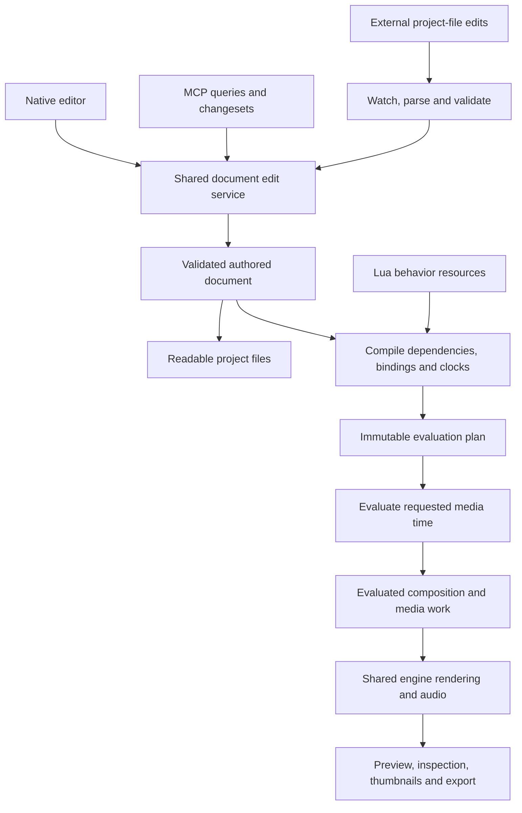

# Flow media engine: final architecture

Status: architecture contract, 2026-10-20. Current native 2D/media refactor acceptance is recorded in `.context/refactor-acceptance.md` (2026-10-21). Specialized future engines and effects remain extensions under section 14. It supersedes the earlier Lua media engine proposal and conflicting binary-document, automation-first and module-first composition directions.

## 1. Product and architectural decisions

Flow is a complete native media authoring platform where humans and agents build, inspect, revise and render the same content. The editor must support complete productions using native capabilities. Lua extends the engine with custom behavior and procedural content, as scripting does in a game engine; it is not required to assemble ordinary scenes.

The foundation is a composition-first media engine with an entity/component scene model. Entities provide identity and hierarchy; components provide data and behavior. Script is a component. Scenes, sequences, beats, tracks, time regions, resources and export jobs are explicit domain objects, not artificial entities introduced merely to satisfy ECS terminology.

Humans and agents have the same authoring capabilities. Either can retime content, configure simulations, create reusable templates, edit behavior, inspect results and export. Their interfaces differ, not their authority over the project. Arbitrary Lua does not need a visual equivalent, but its declared parameters, references, timing and outputs must be inspectable.

The architectural boundaries are:



No editor-only timing implementation, agent-only object model or runtime mutation of saved defaults is permitted.

## 2. Readable project format

Use schema-versioned JSON for structured documents and normal UTF-8 `.lua` files for source. JSON is deliberately a data format: no executable document code, implicit YAML conversions or custom parser language. Publish machine-readable schemas and use stable formatting for human review and agent edits.

```text
project.flow.json
scenes/intro.scene.json
assets/prototypes/title-card.flproto.json
assets/scripts/entrance.lua
assets/...
.flow/cache/                 derived, disposable data
.flow/local/                 local recovery/history metadata
```

The manifest owns project settings, scene order, output settings and a resource catalog mapping stable IDs to project-relative paths. Scenes own entity/component instances, timeline data and placements. Flow prototypes own reusable entity hierarchies and component defaults. Do not fragment every entity or keyframe into a separate file; add explicit subcomposition resources when independent reuse or editing requires them.

Lua scripts and Flow prototypes are first-class project assets, using the same asset catalog, stable resource IDs, dependency tracking, rename/move handling, watching, diagnostics and packaging as images, fonts, audio and video. Asset type determines validation and preparation: Lua compiles as behavior code, while media uses its decoder/importer. A Script component references a Lua asset by ID; it stores instance parameters and bindings, not a private embedded source copy. Multiple components may reference one Lua asset while retaining independent state. Module imports are tracked asset dependencies, not a separate script registry. Asset folders are organizational conventions, not identity or execution semantics.

Use opaque stable IDs for resources, entities, component instances, beats, tracks, regions and keys. Labels, array positions and filenames are not identity. References carry expected target kinds and are validated. Renaming a resource path does not change its ID. Reject duplicate IDs, malformed values, nonfinite numbers, invalid UTF-8 and unsupported schema versions with file/object/property diagnostics.

Serialize unordered records in stable ID order and preserve semantic ordering in explicit arrays. Preserve authored values without rewriting unrelated files. Integer ticks are authoritative for time; frame/sample rates are rational. Generated caches, runtime handles, sampled transforms, checkpoints, thumbnails and compiled Lua are not source documents. A saved project must reopen correctly with its cache directory removed.

Source files are the durable authority. The validated in-memory document is the live working representation, including clearly identified pending edits. Committed editor/MCP changes are saved automatically, with gesture coalescing and a visible save/error state. A failed save leaves an explicitly unsaved change; it must not pretend disk and memory agree. Only an explicit save/discard decision may replace conflicting external content.

## 3. Entity, component and property model

An entity has stable identity, a name, hierarchy and component instances. Transform is a required component. Component schemas specify type/version, multiplicity, defaults, units, constraints, serialization, resource references and editable/animatable properties. Script permits multiple independently identified instances. Singleton native components reject duplicates.

One typed property registry serves Inspector, animation, Lua bindings, MCP, persistence and diagnostics. Resolve stable component/field addresses into numeric handles during compilation. Avoid hard-coded scripting subsets and per-primitive string lookup. Current text, crop, style, appearance, transform and media fields must have consistent coverage. Text uses budgeted variable-length storage, not a small fixed script-output buffer.

Native systems may use packed typed storage and batch processing. ECS is an ownership and scheduling tool, not a requirement to use one universal slow property container. Keep Causality generic: media semantics belong to Flow.

## 4. Reuse and procedural ownership

A Flow prototype (`flproto`) stores an entity subtree with native and Script components, named exposed inputs and resource dependencies. An instance references that resource and stores explicit property, binding and structural overrides. Use stable template-local IDs to preserve overrides across reordering and updates. Missing targets become visible unresolved overrides, never silently bind to another child. Reject recursive prototype/import dependency cycles. Detach materializes a normal subtree through an explicit undoable edit.

Lua behavior resources are reusable independently of Flow prototypes. Parameters and typed bindings supply project-specific entities, components, regions, assets and seeds. Do not bake scene IDs or beat names into reusable source. Resource dependency closure determines what must accompany a template or behavior copied between projects; an external package manager is not a prerequisite.

Behaviors may generate owned children, paths, geometry, instances and particle batches. Stable structural children use identity `(script component ID, local key path)`. Duplicate keys fail validation. Derived defaults remain derived; document overrides and references address stable generated keys without duplicating generated structure as a second authored authority. Missing keys remain unresolved and may recover if restored.

Transient particle/instance elements stay in typed batches rather than thousands of persistent entities. They participate in rendering and inspection with scoped identities. Detach converts selected structural output to authored content; Bake converts sampled results into native data over an explicit interval and tolerance. Neither happens implicitly during playback.

## 5. Lua Script component contract

Keep Lua 5.4 and one Script component contract. A component stores its module resource, enabled state, typed parameters, bindings, time mapping and declared output/layer settings. Each attachment has independent runtime state. Native simulation and effect components expose editor controls too; simulation is not reserved for Lua users.

A module declares its parameter/binding schema and optional capabilities:

| Capability | Responsibility |
| --- | --- |
| Build | Register stable procedural structure, dependencies and output channels from immutable inputs. |
| Initialize | Create explicit simulation state from inputs and seed. |
| Step | Advance explicit state at a fixed local interval using deterministic inputs/events. |
| Sample | Produce validated evaluated output at requested local time without advancing state. |

These are lifecycle capabilities of one component, not separate authoring, effect and simulation script types. A simple motion behavior only needs sampling. A simulated procedural effect can use all four. Project/scene controller behavior attaches to an ordinary owner/root entity and binds explicit targets; it does not require a separate global program type.

The context exposes its entity, resolved component/resource bindings, local clock, typed read access, math/noise/geometry helpers, event inputs and output builders. Broader coordination uses declared target bindings and query dependencies. Script sampling cannot mutate the saved document, call editor commands, perform arbitrary filesystem/network/process access or obtain ambient wall time. Agent file tools operate outside this runtime sandbox.

Outputs are validated before publication. Structural build runs on relevant dependency changes, not every frame. Time-varying topology uses bounded transient collections. Source/import changes compile into a candidate and publish atomically; failed source changes keep the last accepted executable generation with visible stale-source diagnostics. The default successful reload resets the affected instance and replays to the requested time. Explicit state reuse is allowed only with matching compatibility keys; never preserve arbitrary old Lua heap state or native pointers.

## 6. Authored values, animation and behavior composition

Keep authored defaults, template overrides, animation channels and runtime outputs distinct. Evaluation produces a separate composition; it never writes procedural values back into authored component data.

All writers declare targets and layer/blend semantics. Built-in curves, constraints, Lua output and simulation participate in one dependency plan. Replace/add/multiply/blend exist only for types that support them. Ambiguous writers and cycles fail with actionable diagnostics rather than depending on insertion order. Reads use a coherent input view; patches are validated and committed together. Bound dynamic queries participate in dependency invalidation.

Inspector and MCP expose property provenance: default, prototype, override, track, behavior or simulation. Editing a driven property must change an exposed input, edit its track, add an explicit offset/override, or bake/detach. No apparently successful drag that snaps back on the next sample, and no automatic rewriting of arbitrary Lua mathematics.

Constraints and layout declare their dependencies. A native solver may own a supported coupled system; arbitrary cyclic component mutation is not an implicit solver.

## 7. Unified time and retiming

Time regions and mappings are shared by animation, behaviors, simulations, nested compositions, video and audio. A time point is an absolute tick or an explicit stable region/beat reference with normalized position or fixed tick offset. Narrative work defaults to beat-relative bindings. Independent long-running effects and media can use other regions.

Resolve each binding into composition time, local ticks/seconds, duration, normalized progress, before/active/after phase, loop cycle and direction. Delta belongs to fixed-step advancement; it is not the variable editor frame interval. Use half-open activation intervals `[start, end)` and explicit final-value hold sampling. Zero/reversed/unresolved regions have defined inactive/error behavior and cannot divide by zero.

Policies are explicit: stretch maps a canonical duration onto the region; fixed speed preserves local seconds and trims/holds/loops according to settings. Loop and ping-pong specify boundary behavior. Nested mappings compose with cycle detection. Frame times derive from frame index and rational rate, not accumulated floating-point deltas.

Timeline operations are document transactions:

- Rename/reorder follows stable IDs. Cross-beat ranges describe the chronological span between their endpoints; reversed endpoints become invalid rather than silently changing meaning.
- Resize stretches normalized bindings; fixed offsets preserve their declared time units.
- Split partitions the beat but preserves existing region mapping and simulation continuity through explicit endpoint remapping. It must not silently restart behavior or reseed a simulation. Users may separately duplicate/restart an effect.
- Delete leaves affected references explicitly unresolved/inactive with diagnostics. It preserves reusable source and parameter data; undo restores bindings. No silent retargeting to the neighboring beat.

The same operations are available in editor, MCP and readable documents. Retiming never scans or rewrites numeric literals in Lua. Scripts can still intentionally use seconds for physical behavior; the engine maps that local domain into the composition.

## 8. Seekable behavior, simulation and events

Stateful behavior uses explicit bounded serializable state, a versioned seeded PRNG, deterministic ordering, fixed local steps and compatible checkpoints. State supports validated values and engine-managed typed buffers; no hidden functions, coroutines or untracked host pointers.

A request restores the nearest compatible checkpoint, advances fixed steps and samples without changing committed simulation state. Repeated sampling at the same time cannot advance twice. Preview and export have independent evaluation cursors. Checkpoint keys include source/import hashes, parameters, seed, step, input dependencies and numerical backend version. A pure presentation stretch may reuse canonical checkpoints; changed physical inputs may not.

Hidden mutable Lua globals/upvalues must not bypass explicit state. The correctness baseline reconstructs isolated callback environments from cached compiled source and immutable bindings for each invocation; only explicit state and PRNG survive steps. Do not serialize arbitrary Lua heaps. Use native batched services for heavy loops. Optimize callback environment reuse only after an enforceable equivalent isolation mechanism and measured acceptance; measure this cost during the simulation slice before committing to throughput claims.

Recorded media-time events have stable timestamps/order and checkpointed consumption positions. Restoring or seeking replays those events deterministically. Editor lifecycle/document notifications use the observer pattern outside simulation time. Seeking never repeats untracked host side effects. Live input must be recorded/frozen for reproducible export.

Catch-up is cancellable and bounded. Preview reports pending/stale results honestly; exact export waits or fails. Promise equivalent results for the supported engine/math backend within declared numerical tolerances. Cross-platform bit-identical floating-point or GPU simulation requires a separate deterministic backend, not merely a seed.

## 9. Shared editing, files, MCP and history

Move document transactions, validation, history and publication into an engine-owned service. GUI, MCP and watched file changes use it. Operations support expected revisions, dry-run validation, atomic changesets and structured diagnostics. Sampling and generated frame publication are not document edits or history entries.

Use resource/file content hashes and document generations for conflict checks. Coalesce a drag into one semantic history operation. Accepted external edits are history operations too. Undo/redo checks current revisions; it must not overwrite unobserved external changes. Nonconflicting edits may be rebased through semantic operations; conflicting edits are explicit. Do not introduce distributed CRDT infrastructure before simultaneous network editing is a real requirement.

The watcher coalesces events, reads a candidate file set, validates schema/references/dependencies, compiles required resources and publishes one coherent generation. Parse/compile failures preserve the last accepted live generation and identify which disk files differ. Retry interrupted reads with bounded work. Recognize own writes by hashes/revisions to avoid feedback loops. Missing references may be represented as diagnosed inactive bindings; malformed structure or dependency cycles cannot publish executable plans.

Editor/MCP saves use a shared per-project writer lease, atomic file replacement and expected file hashes. Multi-file operations stage their complete candidate, record a recoverable write intent, then publish after completing the file set. Startup recovers interrupted managed writes before loading. Local recovery metadata is not a competing document database.

An arbitrary external editor cannot provide a multi-file transaction guarantee. Individually valid external saves may therefore publish individually. For grouped changes, use an MCP changeset or an explicit watched batch commit with base hashes and a completed file list. A quiet filesystem interval alone is not proof of atomic intent. External conflicts discovered during managed save stop publication and require resolution; filesystem APIs do not provide universal compare-and-swap against noncooperating writers, so retain recoverable content and recheck hashes rather than promising impossible guarantees.

Publish typed change events only after acceptance. Invalidate affected dependencies, not every script and simulation. Every async job/result carries project lifetime, generation and cancellation identity so undo, reload, close and scene changes cannot publish stale work.

## 10. Editor and agent authoring parity

The editor provides hierarchy, Inspector, timeline, resource/template browsing, code editing, simulation controls, diagnostics and visual inspection. Existing shared button/UI components remain the control foundation. Built-in media/effect/simulation tools must support complete productions without requiring custom Lua.

MCP provides schema discovery, project/object inspection, revision-checked edits, timeline operations, component/template management, behavior parameter/source access, simulation configuration, diagnostics, time sampling, rendered captures and export status. Direct file editing remains supported without an MCP connection. Generated output and property provenance are queryable through the same identity model used by picking and Inspector.

Human and agent workflows are symmetric: either can construct, simulate, retime, revise and render. Agent feedback includes evaluated values, selected-time frames, media timestamps and diagnostics. Editor feedback exposes the same information visually. A first-class code editor supports custom logic; universal visual conversion of arbitrary code is not a requirement.

## 11. Media, rendering, export and performance

Use one evaluated composition supporting authored/generated topology, stable picking, typed values, geometry batches and timestamped media work. Replace assumptions that every rendered object has an index in the persisted entity array. Resolve hierarchy, layout, visibility and inherited properties after their dependencies.

Move shared rendering from editor ownership into the engine. Preview, thumbnails, still rendering and export use the same evaluator/renderer with explicit quality settings. Editor overlays are a separate pass. Transport requests time; it does not own simulation advancement.

Video/audio resolve source time from shared placement mappings. Media defaults to fixed source speed, with explicit trim/hold/silence/loop settings. Stretch or pitch-preserving audio processing requires a supported declared backend. Preserve source timestamps and variable frame rates; replace blocking extraction of all video frames at a fixed rate with bounded asynchronous timestamp-based decode/cache. Audio scheduling uses sample-domain timing and native processing, never Lua per sample. Asset-derived audio analysis is cached and deterministic.

Export pins document, Lua/imports, resources, mappings, settings and simulation backend dependencies. Hashing a mutable file is insufficient: retain an immutable resource version or snapshot its bytes for the job. Concurrent edits cannot change later exported frames. Preview/export share audio timing semantics even if codec pipelines differ.

Project mutations and accepted publication have one owner thread. Workers use immutable snapshots, exclusive Lua VM/job ownership and cancellation. Lua receives generation-checked handles, never borrowed pointers. Bound Lua memory/instructions and native helper work, generated topology, dependency sizes, state/checkpoint memory and decode queues. Cache by relevant dependency versions; a color edit must not reset unrelated simulations. Set numeric performance budgets from measured real compositions.

## 12. Direct refactor boundary

| Existing owner | Replacement responsibility |
| --- | --- |
| Project/scene binary codecs | Readable schemas, resource catalog, stable references, deterministic serialization; fresh fixtures. |
| `project/fl_project`, agent history/ops | Shared edit service, revisions, transactions, history, save/recovery and watched publication. |
| Component/schema owners | Component-instance identity and multiplicity; shared typed property metadata and prototype overrides. |
| `components/fl_script`, `scripting/fl_script_runtime` | Script component resource/parameters/bindings and build/initialize/step/sample capabilities. |
| `components/fl_animation`, `time/fl_time`, timeline operations | Shared property channels, regions, clock mappings and atomic retiming rules. |
| `time/fl_scene_state`, geometry | Dependency plan, evaluated composition, generated output and stable picking. |
| `editor/fl_script_sync` | Project resource/source dependency watching and safe candidate reload. |
| Media/cache/audio owners | Timestamp-based decode, shared time mapping, analysis and sample scheduling. |
| `editor/fl_scene_renderer`, playback/export | Engine renderer, time-request transport and immutable-input export. |
| Editor panels and MCP tools | Same document/components/time/provenance/evaluation services through distinct interfaces. |

No migrations, old-format loaders, compatibility callbacks or duplicate old/new runtime owners. Existing projects may be replaced with fresh examples. Do not delete user directories as an incidental implementation step. Retain useful sandbox, allocator, native rendering and mutation safeguards after verifying their current behavior.

## 13. Implementation sequence and completion gates

Deliver complete vertical slices; no placeholder panels or APIs advertising unsupported behavior.

1. **Document foundation:** readable schemas, components/IDs, time bindings, fresh project creation, typed validation and save/reopen. Replace direct persistence callers.
2. **Shared authoring:** editor/MCP/file round trips, watcher, revisions, history, conflict handling, managed multi-file recovery and diagnostics. Timeline changes appear in scene files and external edits appear in the editor.
3. **Native composition and reuse:** complete current native component coverage, prototype instances/overrides and shared property animation. Demonstrate a complete editor-authored composition without custom Lua.
4. **Lua behaviors:** independently attached instances, exposed parameters/bindings, procedural structure, property ownership and atomic reload. Retiming affects native and scripted motion without source edits.
5. **Simulation and evaluation:** explicit state, isolation, replay/checkpoints, native batches, cancellation and arbitrary-time inspection. Measure callback and long-seek costs.
6. **Media/export integration:** shared source-time semantics, decode jobs, engine rendering, immutable export inputs and matched audio/video output.
7. **Joint production acceptance:** build a demanding typography/procedural/simulation/media composition through both editor and agent workflows; either collaborator retimes, edits and diagnoses the other's work.

Required acceptance includes duplicate/missing IDs and generated keys; prototype updates/orphan overrides; multiple Script instances with no shared state; writer conflicts/cycles; zero/reversed regions; beat reorder/resize/split/delete with undo; malformed/partial file saves and source errors; concurrent edits and crash recovery; random/backward seeks versus sequential playback; preview versus export; export during source/resource edits; repeated cancellation and project close during jobs; memory/work limit failures; and clean cache-deleted reopening.

Validate builds and focused tests plus real rendered results, failure/lifecycle paths and measured runtime behavior. A passing build is not visual or performance acceptance. Keep project context notes current as owners change.

## 14. Scope

Implement current native 2D/media capabilities fully through these boundaries first. New paths, effects, physics, shaders, spatial content and specialized simulation components extend the same schemas, resource services and evaluation plan. This design does not promise a 3D engine, package marketplace, arbitrary distributed collaboration or every future effect in the initial refactor.

Success means a production can be created with the editor, extended with Lua, edited by agents through MCP or files, retimed by either collaborator, and rendered reproducibly without competing ownership models.
